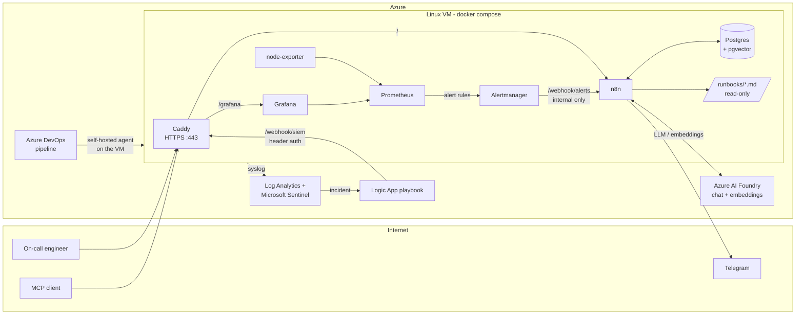
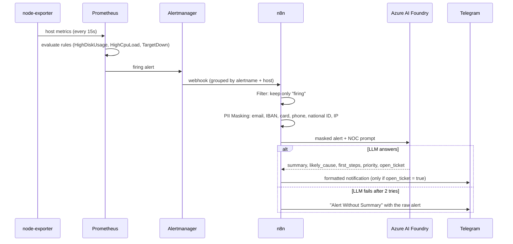
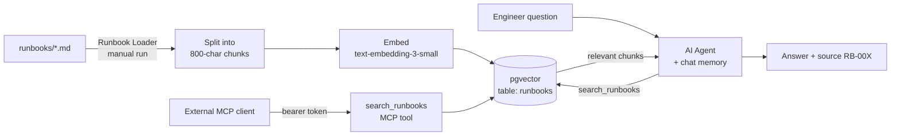

# AI Alert Triage: AI-assisted alert triage

An n8n-based AI automation and monitoring stack running on a single Linux VM in Azure.
Infrastructure alerts and security incidents are summarized by an LLM before they reach the on-call engineer, and a RAG assistant answers questions from the team's runbooks.

## Architecture



### Network boundary
Caddy is the only container with published ports (80/443). It terminates TLS with an automatic Let's Encrypt certificate and routes `/grafana` to Grafana and everything else to n8n. Prometheus, Alertmanager, node-exporter and Postgres are reachable only on the compose internal network. The SSH port is closed; management goes through `az vm run-command` and the pipeline agent.

Caddy returns `403` for `/webhook/alerts*`, so the infrastructure alert webhook can only be called from inside the network (Alertmanager → `http://n8n:5678`). The SIEM webhook is public but requires a header token, and the MCP endpoint requires a bearer token.

### Flow 1: Infrastructure alerts (`ai-alert.json`)



Personal data is masked before anything leaves the VM, and the masked counts are kept on the item (`pii_masked`) for auditing. A structured output parser forces the LLM to return a fixed JSON shape, so the Telegram template never has to parse free text. If the LLM is unavailable, the alert still reaches the engineer without a summary.

### Flow 2: Security incidents (`siem-alert.json`)

1. The VM's syslog is collected into a Log Analytics workspace with Microsoft Sentinel enabled.
2. The analytics rule in `siem/brute-force-rule.kql` raises an incident when one source IP has 5 or more failed SSH logins within 5 minutes.
3. A Logic App playbook posts the incident to n8n's `/webhook/siem` endpoint (header-token protected).
4. **Incident Summary** reduces the large Sentinel payload to the fields that matter: title, severity, MITRE tactics/techniques, target host, source IP, link.
5. The LLM, acting as a SOC analyst, returns a risk level (Low/Medium/High/Critical), likely cause, recommended actions and false-positive likelihood. It recommends; a human decides.
6. Telegram gets the assessment with a link to the incident in Defender. The same fallback applies as in flow 1.

`scripts/demo-brute-force.sh` writes simulated failed-login lines from a documentation IP range (`203.0.113.0/24`) to trigger this flow without a real attack.

### Flow 3: Runbook assistant (RAG)



- **Runbook Loader** reads the Markdown files mounted read-only at `/data/runbooks` (n8n is restricted to that directory), splits them into chunks with 100 characters of overlap, embeds them and stores them with the file name as `source` metadata.
- **Runbook Assistant** is a chat agent that must call `search_runbooks` first, answer only from the returned chunks, cite the runbook, flag risky steps, and escalate instead of guessing when nothing relevant is found.
- **Runbook MCP** exposes the same search as an MCP tool, so other AI clients (for example an IDE assistant) can use the team's runbooks.

The same Postgres instance stores n8n's own data and the vectors, which keeps the stack to a single database.

### Deployment
Every push to `main` runs `azure-pipelines.yml` on a self-hosted agent installed on the VM, so no inbound SSH is needed. The pipeline:

1. validates `docker-compose.yml`,
2. syncs the repo to `/opt/gh-demo` and writes `.env` (mode 600) from secrets in an Azure DevOps variable group,
3. runs `docker compose pull` + `up -d` and restarts the containers whose bind-mounted configs may have changed (Caddy, Prometheus, Alertmanager),
4. smoke-tests `https://<domain>/healthz` until n8n responds.

The n8n version is pinned in the pipeline (`N8N_VERSION`), so upgrades are a one-line, reviewable change.

## Components
| Service | Role |
|---|---|
| Caddy | HTTPS (automatic certificates), reverse proxy |
| n8n | Automation workflows, AI steps |
| Postgres + pgvector | n8n database and vector store for RAG |
| Prometheus, node-exporter | Metrics collection, alert rules |
| Alertmanager | Groups alerts and forwards them to n8n |
| Grafana | Dashboards |

## n8n workflows (`workflows/`)
| Workflow | What it does |
|---|---|
| `ai-alert.json` | Receives Alertmanager alerts, masks PII, asks the LLM for a summary, likely cause and first steps, sends the result to Telegram. Falls back to the raw alert if the LLM fails. |
| `siem-alert.json` | Receives Microsoft Sentinel incidents (via a Logic App playbook), asks the LLM for a SOC-style assessment, sends it to Telegram. |
| `runbook-loader.json` | Reads `runbooks/*.md`, embeds them and stores them in pgvector. |
| `runbook-assistant.json` | Chat agent that answers on-call questions using only the runbooks (RAG). |
| `runbook-mcp.json` | Exposes the runbook search as an MCP tool (bearer-token protected). |

After importing, attach your own credentials (Azure OpenAI / Foundry, Postgres, Telegram, header/bearer auth) and replace `<your-telegram-chat-id>`.

## Security decisions
- Network exposure is described in [Network boundary](#network-boundary).
- Secrets are not in the repo: they are stored as secrets in an Azure DevOps variable group and written to `.env` (mode 600) at deploy time.
- Personal data is masked before alerts are sent to the LLM, and both LLM prompts forbid personal data in the output.
- AI output is advisory: the SIEM flow recommends actions but never executes them.

## Scripts
- `scripts/check-disk.sh`: Reports disks above a threshold as JSON.
- `scripts/service_health.py`: Checks the health of the compose services and posts to a webhook if something is wrong.
- `scripts/demo-disk-alarm.sh fill|clean`: Fills the disk for a demo to trigger the HighDiskUsage alert.
- `scripts/demo-brute-force.sh`: Writes simulated failed SSH login lines to syslog to trigger the Sentinel rule in `siem/`.

## Test
```bash
curl -X POST https://<domain>/webhook-test/alerts -H 'Content-Type: application/json' -d @samples/alertmanager-alert.json
```

## Known gaps (demo)
- Single VM, no high availability. In production: n8n queue mode + multiple workers.
- Backups: scheduled `pg_dump` for Postgres and Azure Backup should be added.
